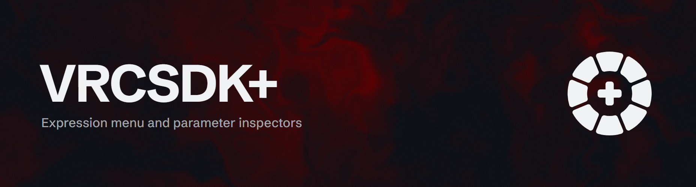
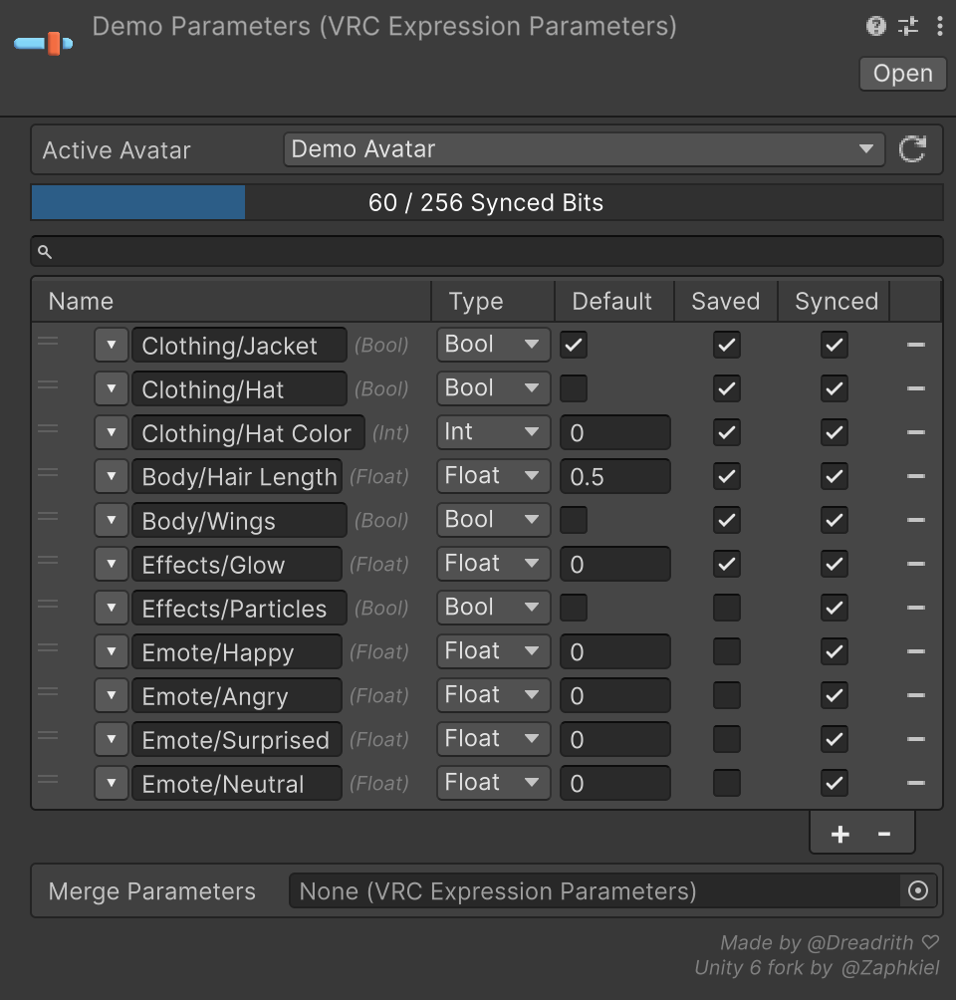
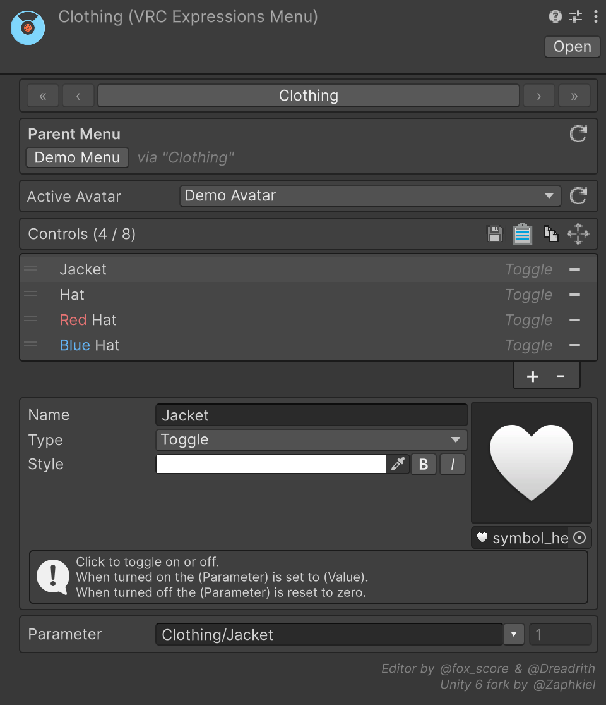
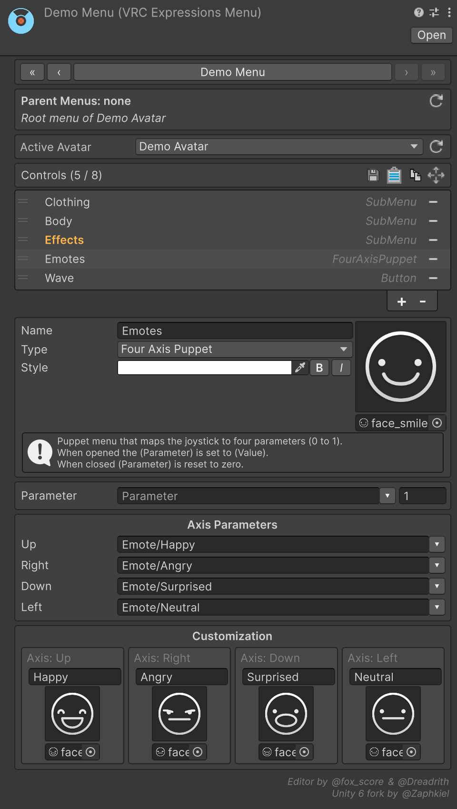

Custom inspectors for VRChat Expression Parameters and Expression Menus, plus a Quick Setup command for the Avatar Descriptor. VRCSDK+ replaces the SDK inspectors in the editor and leaves the SDK files untouched.

This repository is a Unity 6 fork of [VRCSDK+](http://web.archive.org/web/20241229010952/https://github.com/Dreadrith/VRCSDKPlus) 1.6.0 by Dreadrith. Both inspectors run on UI Toolkit, and the code supports the parameter fields added in VRChat SDK 3.11.

## Features

### Expression Parameters inspector

- Synced bits bar, computed with the SDK's own cost function, bit widths included.
- Table with resizable columns: name, type, default value, saved, synced. Rows reorder by drag. With 152 parameters the inspector repaints in about 3 ms.
- Search by name.
- Picker listing the parameters declared by the active avatar's playable layers, with their controller type.
- Warnings for blank, duplicate and missing parameters. "Add" creates a missing parameter in one of the avatar's controllers. "Cleanup" removes the faulty entries after a confirmation.
- Merge of another Expression Parameters asset, with every field copied.

<p align="center">
  
</p>

### Expression Menu inspector

- Parent menus: the menus that open this one as a submenu, the controls that do it, and the avatars in the open scenes that use it as their root menu.
- Back and forward history between visited menus.
- Copy, paste, duplicate, cut and place of controls, within a menu or across menus. Copies keep their icon and submenu after an editor restart.
- Control details: name, type with parameter conversion, text color, bold and italic, icon, parameter picker, value matched to the parameter type, submenu creation, puppet axes and labels.
- Repair button for controls with missing axis parameters or labels. Drawing the inspector never writes to the asset.
- Compact layout.

<p align="center">
  
  
</p>

### Quick Setup

Fills the Avatar Descriptor from the humanoid rig: view position between the eyes, eye bones and look rotations, eyelid blend shape when a direct child mesh has a `Blink` shape, and lip sync auto-detection.

## Requirements

| Dependency | Version |
| --- | --- |
| Unity | 6000.0 (tested with 6000.0.67f1) |
| VRChat Avatars SDK | 3.11.0 or later (tested with 3.11.0-beta.1) |

## Installation

1. Remove the VCC package `com.dreadscripts.vrcsdkplus` if your project has it. With both installed, two copies register the same inspectors and menu items.
2. Clone the repository anywhere under `Assets`:

   ```sh
   git clone https://github.com/ZaphkielTools/VRCSDKPlus.git Assets/VRCSDKPlus
   ```

   If your project is a git repository, add it as a submodule instead:

   ```sh
   git submodule add https://github.com/ZaphkielTools/VRCSDKPlus.git Assets/VRCSDKPlus
   ```

   You can also download the ZIP from GitHub and extract it into `Assets/VRCSDKPlus`.

## Usage

Select an Expression Parameters or Expression Menu asset. VRCSDK+ draws its inspector in place of the SDK one.

| Action | How |
| --- | --- |
| Switch back to the SDK inspector | Right-click the asset's Inspector header > `[SDK+] Toggle Editor`. The choice applies to every project on this computer. |
| Pick the avatar to check against | `Active Avatar` field at the top of either inspector |
| Compact layout of the menu inspector | Inspector window menu (⋮) > `Compact Mode` |
| Quick Setup | Right-click the VRC Avatar Descriptor header > `[SDK+] Quick Setup` |

### Keyboard shortcuts

| Shortcut | Parameters inspector | Menu inspector |
| --- | --- | --- |
| Ctrl+F | Focus the search field | |
| Ctrl+C | | Copy the selected control |
| Ctrl+X | | Cut the selected control |
| Ctrl+V | | Paste as a new control, or place the cut control after the selection |
| Ctrl+D | Duplicate the selected parameter | Duplicate the selected control |
| Delete | Remove the selected parameter | Remove the selected control |
| Escape | | Cancel a cut |

Hold Shift while duplicating a control to keep its parameter, or while placing a cut control to return to the menu it came from.

## Tests

The EditMode tests live in `Tests/`. Open Window > General > Test Runner, select EditMode and run `Zaphkiel.Editor.VRCSDKPlus.Tests`. Some tests create a temporary folder under `Assets` and delete it when they finish.

`EditorOverrideTests` fails when a Unity update changes the internal editor cache that VRCSDK+ patches to replace the SDK inspectors. Run the tests after each Unity upgrade.

## Project layout

| Folder | Content |
| --- | --- |
| `Core/` | Inspector override, active avatar, expression parameter rules, text helpers |
| `UI/` | Shared UI Toolkit elements and the `VRCSDKPlus.uss` style sheet |
| `Parameters/` | Expression Parameters inspector |
| `Menus/` | Expression Menu inspector and parent menu index |
| `Avatar/` | Quick Setup |
| `Tests/` | EditMode tests |
| `Documentation~/` | README images. Unity skips folders whose name ends with `~`. |

## Contributing

Commit messages follow [Conventional Commits](https://www.conventionalcommits.org/en/v1.0.0/). Use the folder name as the scope, for example `fix(menus): keep the selection after undo`. [CHANGELOG.md](CHANGELOG.md) lists the changes of each version.

## Credits

- **[Dreadrith](https://github.com/Dreadrith)**: author of VRCSDK+. Support Dreadrith on [Ko-fi](https://ko-fi.com/Dreadrith) or [Gumroad](https://dreadrith.gumroad.com/l/VRCSDKPlus).
- **[foxscore](https://github.com/foxscore)**: co-author of the Expression Menu inspector.
- **buddy**: smart increment of parameter and control names (VRCSDK+ 1.5.0).
- **m1s0**: submenu names taken from the control name (VRCSDK+ 1.5.0).
- **Zaphkiel** ([ZaphkielTools](https://github.com/ZaphkielTools)): Unity 6 fork.

## Upstream status

On 2026-11-21 the original repository, its release downloads and the DreadScripts VPM listing returned 404, so the VCC can no longer install VRCSDK+. The first commit of this repository holds the unmodified 1.6.0 package, taken from a VCC cache.

## License

VRCSDK+ is free software under the GNU General Public License v3.0. See [LICENSE.md](LICENSE.md).

- Copyright (C) Dreadrith: VRCSDK+ up to 1.6.0.
- Copyright (C) 2026 Zaphkiel: changes made in this fork.
